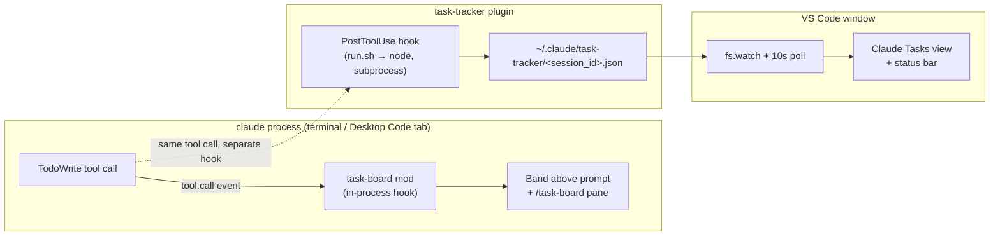

# Claude Code Task Board

See Claude's task list — and every subagent's, nested underneath — while it works. In your
terminal, in the Claude Desktop app, and in a VS Code sidebar.

```
 Tasks 3/7 ▸ Writing the hook
   ↳ testing-playwright-jest 1/2 ▸ Running the suite
                                                        Show all
```

Claude Code already tracks its own plan internally (the `TodoWrite` tool). This project just
makes that plan visible, persistently, instead of scrolling past in the transcript — including
the plans of subagents working in the background.

> Not affiliated with or endorsed by Anthropic. Claude and Claude Code are trademarks of
> Anthropic. "VS Code" refers to Microsoft's editor; nothing here is a Microsoft product either.

## What's in the box

Four independent components, installed separately, each solving one part of "where do I see this":

| Component | What it is | Where it shows |
|---|---|---|
| **task-board** | A Claude Code *mod* — in-process function hooks (`plugins/task-board/hooks/register.tsx`) | A band above the prompt, plus a `/task-board` pane. **Terminal only** (including VS Code's and JetBrains' integrated terminals) and the Claude Desktop app's Code tab. |
| **task-tracker** | A Claude Code *plugin* — classic settings hooks (`plugins/task-tracker/hooks/hooks.json`) | Nowhere by itself. It writes each session's task list to `~/.claude/task-tracker/<session_id>.json` so something else can read it. |
| **statusline** | A standalone bash script (`statusline/task-statusline.sh`) + `install.sh` | Claude Code's status line: `Opus 5.5 · my-repo · ✓ 3/7 ▸ Writing the hook`. Terminal. Needs no plugin and no node — it reads the session transcript directly. |
| **vscode-extension** ("Task Board for Claude Code") | A standalone VS Code extension (`vscode-extension/`) | A "Claude Tasks" sidebar view and a status bar item. Reads task-tracker's files — **requires task-tracker to be installed too.** Also shows plans from the **OpenAI Codex CLI**, read directly from Codex's own session files — no plugin or hook needed for that part. |

You can install task-board or the status line on their own for terminal/Desktop use. The VS Code sidebar needs both
task-tracker (to produce the data) and the extension (to display it).

## Requirements

- Claude Code CLI **2.1.287 or newer** for task-board in a terminal; Claude Desktop **2.1.286 or
  newer** for the Code tab. Mods are an early-access feature — see `claude plugin --help`.
- **Node.js** on `PATH` (or a default Homebrew/Volta/nvm install) for task-tracker's hook. No
  node → the hook quietly does nothing; nothing breaks, but no state files get written.
- **VS Code 1.90+** for the vscode-extension.
- On Claude 5 models, Claude Code's `TodoWrite` tool is **off by default** — nothing here has
  anything to show until it's turned on (see Install, step 2). Where Claude Code uses the newer
  **Task tools** instead (`TaskCreate`/`TaskUpdate` — the Desktop app does), everything here reads
  those too.
- **Optional:** the vscode-extension also shows plans from the **OpenAI Codex CLI** — no
  install step needed beyond having used Codex CLI at least once (it reads
  `~/.codex/sessions/**/rollout-*.jsonl` directly). Turn it off with `claudeTasks.codexEnabled`
  if you don't use Codex.

## Install

1. **Clone this repo.**

   ```bash
   git clone https://github.com/OWNER/claude-code-task-board.git
   cd claude-code-task-board
   ```

   (`OWNER` is a placeholder — this repo isn't pushed anywhere yet. Until then, install from your
   local clone using the path-based command in step 3.)

2. **Turn on the todo tool, if you're on a Claude 5 model.** Claude Code enables `TodoWrite` by
   default only for older (Claude 3/4) models. On Claude 5 it stays off unless
   `CLAUDE_CODE_ENABLE_TODO_TOOLS=1` is set — and a plugin can't set environment variables itself,
   so this is a one-time script instead:

   ```bash
   ./scripts/enable-todo-tool.sh        # writes CLAUDE_CODE_ENABLE_TODO_TOOLS=1 into ~/.claude/settings.json
   ./scripts/enable-todo-tool.sh --undo # reverts it (a timestamped backup is also kept)
   ```

   Restart any open Claude Code sessions afterward.

3. **Add the marketplace and install the plugins.** From your local clone:

   ```bash
   claude plugin marketplace add /path/to/claude-code-task-board
   claude plugin install task-board@task-board-suite
   claude plugin install task-tracker@task-board-suite
   ```

   Once this repo is pushed to GitHub, the first line becomes (`OWNER` placeholder again):

   ```bash
   claude plugin marketplace add OWNER/claude-code-task-board
   ```

4. **If a Claude Code session was already open**, run `/reload-plugins` inside it rather than
   restarting.

5. **Optional — the VS Code sidebar.** Not on the VS Code Marketplace yet, so build the `.vsix`
   yourself:

   ```bash
   cd vscode-extension
   npm run package                       # → dist/task-board-vscode.vsix
   code --install-extension dist/task-board-vscode.vsix
   ```

   Then run **Developer: Reload Window** in VS Code (reloads only that window).

6. **Make sure Claude actually writes task lists.** Lists only exist when Claude uses the todo
   tool, which it does for its own judgment on multi-step work — it won't always reach for it.
   Adding something like this to your project's `CLAUDE.md` makes it reliable:

   ```markdown
   Record every multi-step plan (3+ steps) as a task list with TodoWrite before starting;
   keep exactly one item in_progress; mark each completed as soon as it's done.
   ```

   Subagents pick up `TodoWrite` too, so delegated work shows up nested automatically — where a
   subagent has a task tool at all (see the Desktop note under Troubleshooting).

7. **Optional — the status line.** Independent of everything above (no plugin, no node):

   ```bash
   ./statusline/install.sh              # copies the script to ~/.claude/statusline/ and sets statusLine
   ./statusline/install.sh --force      # replace a status line you already have (backup kept)
   ./statusline/install.sh --uninstall
   ```

## Usage

**In a terminal (or the Desktop app's Code tab):** a band appears above the prompt the moment
Claude writes a task list — `Tasks 3/7 ▸ <current step>`. Each subagent running in the background
gets its own nested line, `↳ <agent-type> 1/2 ▸ <step>`, as soon as it starts. The band carries a
**Show all** button that expands every task in every list (subagent tasks indented one level
deeper than their header); it becomes **Collapse** once expanded. `/task-board` opens the same nested
outline in a pane beside the transcript, already fully expanded — useful once the band's row cap
hides something ("… N more (/task-board)").

**In VS Code:** open the **Claude Tasks** icon in the activity bar. It lists every session with an
active task list — Claude Code sessions (via task-tracker) and, if you use it, Codex CLI sessions
with a plan — the one matching your focused Claude chat tab on top and expanded, the rest
collapsed and sorted newest-first. Each session shows `done/total · Claude · relative time` or
`done/total · Codex · relative time` so you can tell the two apart; expand it for the task rows
(✅ done, ⏳ in progress, ⬜ pending) and any nested subagent group, labeled `<type> (subagent)` and
expanded automatically while running (Codex plans are flat — never nested). The status bar mirrors
whichever list is currently focused — your own session's, or a running subagent's if the session
itself has none right now — with a small robot icon when it's a subagent's. You can drag the
"Claude Tasks" view out of the activity bar into the secondary sidebar or the bottom panel if
you'd rather keep it there. The view's badge count is how many sessions still have unfinished
work.

Note: the VS Code *extension* runs independently of Claude Code's own VS Code integration. If
you're chatting with Claude inside VS Code's built-in chat panel, that panel is a separate,
closed webview — it can't be extended, so this sidebar and status bar live beside it, not inside
it.

## How it works

Both task-board and task-tracker watch the same signal — Claude's `TodoWrite` tool call — but
through two unrelated mechanisms, because one runs inside the `claude` process and the other runs
as an external hook with no shared memory:



- **task-board** reads the tool call directly (`tool.call` for `TodoWrite`, so a subagent's own
  `e.agentId` keys its list apart from the main session's) and keeps everything in in-memory
  plugin state (`$.state` atoms, which survive a hot reload). `classic.SubagentStart` labels each
  subagent by its agent type; `classic.SubagentStop` removes that subagent's list; `/clear`
  (`session.end`) clears everything. Nothing is written to disk.
- **task-tracker** reacts to the identical tool calls from *outside* the process, via Claude
  Code's classic `PostToolUse`/`SubagentStop`/`SessionEnd` hooks, and has to persist what it sees
  to a file because its subprocess exits after every call. `SessionEnd` deletes the session's
  file outright.
- The **vscode-extension** has no connection to Claude Code at all — it only reads that file.
  It watches the state directory (`fs.watch`, debounced ~150ms) and also polls every 10 seconds,
  because closing a Claude tab doesn't necessarily touch the file.

**Codex CLI plans are a third, independent path**, with no hook or plugin involved at all:
`vscode-extension/lib/codex.js` reads OpenAI Codex CLI's own session rollout files
(`~/.codex/sessions/**/rollout-*.jsonl`) directly and merges them into the same tree, tagged
`source: "codex"`. See [`docs/features/vscode-codex-plans.md`](docs/features/vscode-codex-plans.md)
for the full schema notes and the approximations that implies.

See [`docs/how-it-works.md`](docs/how-it-works.md) for the full state file contract and the
reasoning behind each signal — useful if you're extending this rather than just using it.

## Configuration

All settings are read by the VS Code extension (`claudeTasks.*`, under Settings → Extensions →
Claude Tasks):

| Setting | Default | Meaning |
|---|---|---|
| `claudeTasks.currentWorkspaceOnly` | `true` | Only show sessions whose working directory is inside a currently open workspace folder. |
| `claudeTasks.maxAgeHours` | `24` | Hide a session once its task list has gone this many hours without an update. `0` = never hide. |
| `claudeTasks.stateDir` | `""` | Where to read task-tracker's files from. Empty means `~/.claude/task-tracker`. |
| `claudeTasks.codexEnabled` | `true` | Also show plans from the OpenAI Codex CLI, read directly from its session rollout files. |
| `claudeTasks.codexSessionsDir` | `""` | Directory of Codex CLI rollout session files. Empty means `~/.codex/sessions`. |

task-tracker itself has one override, read from the environment rather than a setting:
`TASK_TRACKER_DIR` — point it elsewhere if `~/.claude/task-tracker` doesn't suit you (e.g. a
sandboxed `$HOME`). Set it consistently for the hook and for `claudeTasks.stateDir`, or the two
will disagree about where the files live.

## Troubleshooting / FAQ

**Nothing shows in my terminal.** Check `claude --version` (needs 2.1.287+), check that
`CLAUDE_CODE_ENABLE_TODO_TOOLS` is set if you're on a Claude 5 model (step 2 above), and check
that Claude actually used `TodoWrite` for this task — a one- or two-step request often won't
trigger it. The CLAUDE.md instruction in step 6 fixes that last one.

**I see no band in a new session.** It appears only once Claude writes a task list (TodoWrite or
TaskCreate) in that session; an empty board draws nothing. Ask for multi-step work, or open the
pane with `/task-board`. If `/task-board` is not offered as a command, the mod did not load: run
`/plugin` and check the dim line under the tabs (`1 mod active · task-board`), and `claude
--version` (2.1.287+).

**In the Desktop app I only see the built-in "Plan → Tasks" pane, not the band.** That pane is the
Desktop app's own and shows the main list only. The task-board band sits above the prompt and needs
the Desktop app's bundled Claude Code to be **2.1.286+** (a 2.1.280 Desktop build was seen without
it; check with `/status`). The Desktop app uses `TaskCreate`/`TaskUpdate` rather than `TodoWrite`;
the band, the status line and task-tracker all read both.

**My subagent's tasks don't appear nested.** A subagent can only report a list if it has a task
tool. In a Desktop-app session on 2.1.280 the subagent searched for `TaskCreate`/`TaskUpdate` and
for a todo tool and found neither, so there was nothing to nest. In sessions where subagents get
`TodoWrite` (verified in the VS Code extension and the CLI with the env flag), nesting works.

**Nothing shows in VS Code's built-in chat panel.** Expected — mods only draw in a terminal or the
Desktop app's Code tab; the chat panel runs the hooks but renders nothing for them. That gap is
why the sidebar extension exists; use that instead.

**The VS Code sidebar is empty.** Sessions that were already open when task-tracker was installed
record nothing until they run `/reload-plugins` (or restart), and a window keeps the extension
version it loaded until **Developer: Reload Window**. Otherwise, confirm task-tracker is installed (the extension only reads its
output, it generates nothing itself), that Node is resolvable by `plugins/task-tracker/run.sh`,
and — if `claudeTasks.currentWorkspaceOnly` is on — that the session's working directory is
actually inside an open workspace folder.

**A session vanished from the sidebar right after I expected it to.** That's `SubagentStop` or
`SessionEnd` doing their job — a finished subagent's list is removed the moment it stops, and a
session's file is deleted when it ends (exit, `/clear`, logout).

**A long-closed session is still listed.** The extension double-checks against Claude Code's own
session registry (`~/.claude/sessions/<pid>.json`) and removes anything confirmed closed within
about 10 seconds, with a 60-second grace window after any update (to avoid a race on session
start). If that registry is itself empty or unreadable, it falls back to the PID the hook
recorded; failing that too, an untouched list is only *hidden* once idle for an hour — it's never
guessed closed.

**Why isn't the VS Code extension on the Marketplace?** It isn't published yet — build and
install the `.vsix` locally (Install, step 5).

## Limitations & caveats

Read this before relying on any of it for something important:

- The VS Code extension leans on **undocumented Claude Code internals**: the `~/.claude/sessions`
  registry's file shape, the transcript's `ai-title` rows for a session's display name, and the
  CLI's own model allowlist for enabling `TodoWrite`. Any of these can change in a future Claude
  Code release without notice.
- Session-to-tab matching is by **title text**. If VS Code truncates or you manually rename a tab,
  matching falls back to "the newest unfinished session" — usually right, not guaranteed.
- If a PID gets reused by an unrelated process after a session ends, a stale list can survive
  until the idle-hide window (default 24 hours via `maxAgeHours`) closes it.
- `TaskCreate`/`TaskUpdate` support is built from one real Desktop-app transcript (Claude Code
  2.1.280): create takes `{subject, description, activeForm}` and returns `{task: {id}}`; update
  takes `{taskId, status}` (`deleted` removes). Other versions may differ; task-tracker also tries
  a few alternative field names defensively.
- The status line parses JSON with grep/awk, assuming Claude Code's key order for todo items
  (`content`, `status`, `activeForm`) — true in every transcript examined, not guaranteed.
- The mod API (`claude-code` mods) is early access; expect its own breaking changes upstream.
- The vscode-extension has been tested on macOS and Linux. Windows is untested.
- Everything stays local. State files contain your task text in plain JSON on disk — nothing is
  sent anywhere by any of these three components.
- **Codex CLI support is read from an undocumented, unversioned file format** (Codex's own
  rollout `.jsonl` files), reverse-engineered from real files on one machine (Codex CLI 0.159.2) —
  not a published contract, and it can change without notice. Two further approximations worth
  knowing: a Codex session is only considered "ended" once its rollout file has gone 15 minutes
  without being touched (there's no liveness registry like Claude Code's to check instead); and a
  Plan Mode plan (markdown with no per-step status) shows every line as pending until Codex's
  `task_complete` event for that plan's turn arrives, at which point *all* of its lines flip to
  completed together — never partially. Codex's `update_plan` tool (which does carry per-step
  status) was never observed in real local history; its parsing is implemented from Codex's own
  published tool schema, not from a confirmed example. See
  [`docs/features/vscode-codex-plans.md`](docs/features/vscode-codex-plans.md) for the full detail.

## Development

```bash
scripts/test-all.sh
```

Runs, in order: `node --test` for task-tracker's hook, `node --test` for the vscode-extension's
model and Codex layers, `statusline/test/run.sh` (plain bash), then — only if a `claude` CLI ≥ 2.1.287 is on `PATH` (override with `CLAUDE_BIN`) —
`claude plugin validate` on the marketplace root and both plugins, and `claude plugin test` for
the task-board mod. CI (`.github/workflows/test.yml`) runs the two `node --test` suites and the
status-line tests;
the plugin-validation and mod-test steps need the Claude Code CLI and are local-only for now.

| Path | Role |
|---|---|
| `.claude-plugin/marketplace.json` | The `task-board-suite` marketplace definition both plugins are installed from. |
| `plugins/task-board/` | The mod: `hooks/register.tsx` (logic + UI), `hooks/hooks.json`, `types/index.d.ts`, `tests/`. |
| `plugins/task-tracker/` | The plugin: `hooks/hooks.json`, `hook/task-tracker-hook.mjs` (entry point), `lib/state.mjs` (state file contract), `run.sh` (node launcher), `test/`. |
| `vscode-extension/` | The extension: `extension.js` (VS Code glue), `lib/model.js` (pure, unit-tested data layer for Claude/task-tracker sessions), `lib/codex.js` (pure, unit-tested data layer for Codex CLI sessions), `package.json`, `test/`, `media/`. |
| `statusline/` | `task-statusline.sh` (the status line), `install.sh`, `test/run.sh`. |
| `scripts/` | `enable-todo-tool.sh`, `test-all.sh`. |
| `docs/how-it-works.md` | The state file contract and design rationale, for contributors. |
| `docs/features/` | Feature briefs with full AI-resumption context. |
| `docs/release-notes/` | Dated release notes. |

##Screenshots
VS Code extension
Multiple Sessions

With Sub Agents


VS Code Status bar


## License

[MIT](LICENSE) — Copyright (c) 2026 Mamdouh.

---

Not affiliated with or endorsed by Anthropic. Claude and Claude Code are trademarks of Anthropic.
